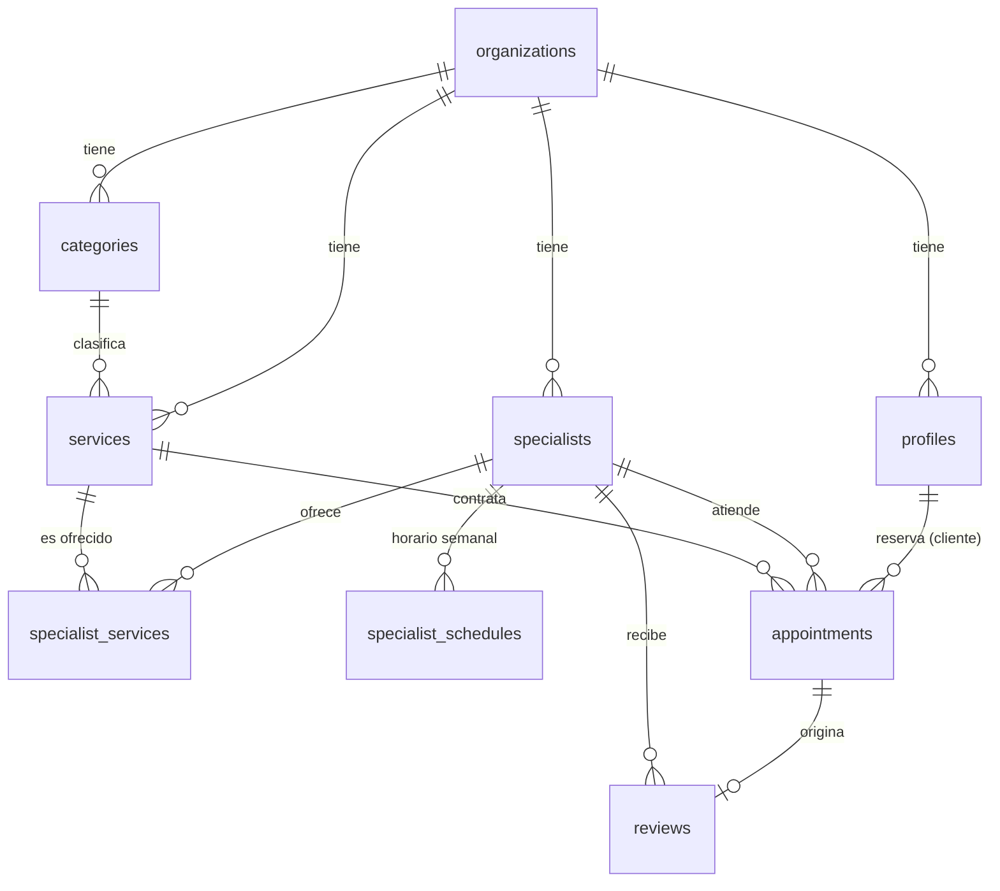

# Modelo de datos (Supabase / Postgres)

Script: `supabase/migrations/0001_init.sql` · datos demo: `supabase/seed.sql`. El script se probó en un Postgres real (triggers, RLS, RPC y restricción anti-solape).



**Entidades para la rúbrica:** maestras = `specialists` y `services`; transaccional = `appointments` (relacionada con ambas, más el cliente).

## Decisiones clave
- **Multi-organización:** toda tabla de negocio tiene `organization_id`; RLS aísla los datos por organización. Una organización nueva = una fila en `organizations` (+ su catálogo).
- **Roles** (`profiles.role`): `client` (por defecto), `specialist`, `admin`. El rol **no** lo elige la app: el trigger `handle_new_user` siempre crea `client`; un admin se asciende desde el panel de Supabase/SQL.
- **Reglas en la BD (no confiar en el cliente):** el trigger de `appointments` calcula `end_at`, fija el precio vigente, valida organización y que el especialista ofrezca el servicio; la restricción `no_double_booking` impide solapes (error `23P01` → "horario ya tomado").
- **Disponibilidad:** RPC `get_available_slots(p_specialist_id, p_service_id, p_date)` devuelve huecos cada 30 min dentro del horario semanal, descontando turnos activos.
- **Calificaciones:** vista `specialist_overview` (promedio y conteo). Una reseña solo se crea sobre un turno propio `completed` (trigger).
- **Zona horaria:** se guardan `timestamptz` en UTC; la app convierte con `toLocal()`. El horario del especialista se interpreta en `organizations.timezone`.

## Cambios al esquema
Crear `supabase/migrations/000N_<descripcion>.sql`, ejecutarlo en el SQL Editor y avisar al equipo. Nunca editar migraciones ya aplicadas.

## Crear un admin / especialista con login (demo)
```sql
update public.profiles set role = 'admin' where id = '<uuid del usuario>';
update public.specialists set profile_id = '<uuid del usuario>' where id = '<uuid del especialista>';
```
